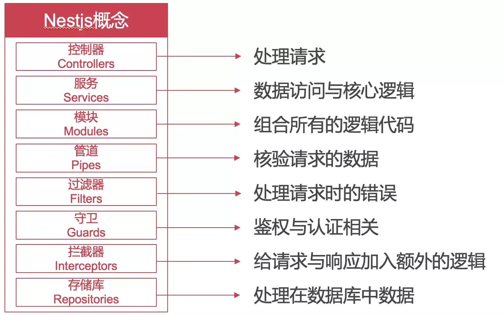
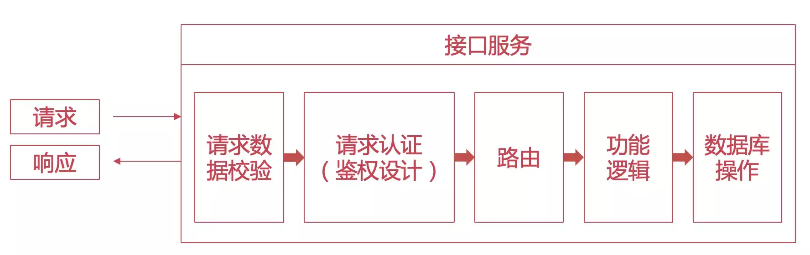
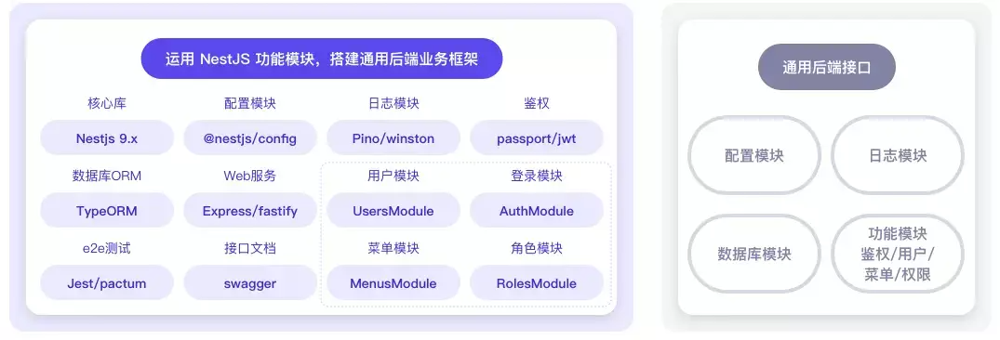
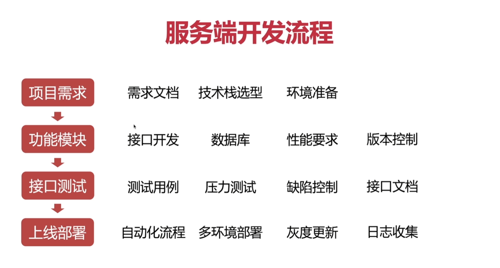
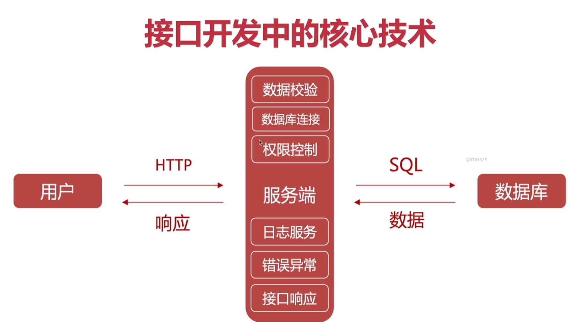

# NestJS

<!-- @import "[TOC]" {cmd="toc" depthFrom=1 depthTo=6 orderedList=false} -->

<!-- code_chunk_output -->

- [NestJS](#nestjs)
  - [一. NestJS 简介](#一-nestjs-简介)
  - [二. NestJS 基础](#二-nestjs-基础)
    - [2.1 API 类型](#21-api-类型)
      - [2.1.1 RESTful API](#211-restful-api)
      - [2.1.2 GraphQL API](#212-graphql-api)
      - [2.1.3 WebSocket API](#213-websocket-api)
    - [2.2 最佳实践](#22-最佳实践)
      - [2.2.1 模块化设计](#221-模块化设计)
      - [2.2.2 依赖注入](#222-依赖注入)
      - [2.2.3 中间件](#223-中间件)
      - [2.2.4 错误处理](#224-错误处理)
      - [2.2.5 日志记录](#225-日志记录)
      - [2.2.6 性能优化](#226-性能优化)
      - [2.2.7 安全性](#227-安全性)
      - [2.2.8 代码规范](#228-代码规范)
    - [2.3 装饰器](#23-装饰器)
      - [2.3.1 类装饰器](#231-类装饰器)
        - [2.3.1.1 @Controller](#2311-controller)
        - [2.3.1.2 @Injectable](#2312-injectable)
        - [2.3.1.3 @Module](#2313-module)
        - [2.3.1.4 @Catch](#2314-catch)
        - [2.3.1.5 @WebSocketGateway](#2315-websocketgateway)
        - [2.3.1.6 @Resolver](#2316-resolver)
      - [2.3.2 方法装饰器](#232-方法装饰器)
        - [2.3.2.1 控制器 HTTP 路由相关 @Get/@Post/@Put/@Delete/@Patch/@Options/@Head/@All](#2321-控制器-http-路由相关-getpostputdeletepatchoptionsheadall)
        - [2.3.2.2 控制器方法行为相关](#2322-控制器方法行为相关)
        - [2.3.2.3 GraphQL 相关](#2323-graphql-相关)
        - [2.3.2.4 WebSocket 相关](#2324-websocket-相关)
        - [2.3.2.5 微服务相关](#2325-微服务相关)
        - [2.3.2.6 定时任务相关](#2326-定时任务相关)
      - [2.3.3 属性装饰器](#233-属性装饰器)
        - [2.3.3.1 @Inject](#2331-inject)
        - [2.3.3.2 @Optional](#2332-optional)
      - [2.3.4 参数装饰器](#234-参数装饰器)
        - [2.3.4.1 @Param](#2341-param)
        - [2.3.4.2 @Query](#2342-query)
        - [2.3.4.3 @Body](#2343-body)
        - [2.3.4.4 @Headers](#2344-headers)
        - [2.3.4.5 @Req](#2345-req)
        - [2.3.4.6 @Res](#2346-res)
        - [2.3.4.7 @Next](#2347-next)
        - [2.3.4.8 @Ip](#2348-ip)
        - [2.3.4.9 @Session](#2349-session)
        - [2.3.4.10 @HostParam](#23410-hostparam)
        - [2.3.4.11 @UploadedFile / @UploadedFiles](#23411-uploadedfile--uploadedfiles)
      - [2.3.5 自定义装饰器](#235-自定义装饰器)

<!-- /code_chunk_output -->

## 一. NestJS 简介

NestJS 是一个用于构建高效、可扩展的 Node.js 服务器端应用程序的框架。它基于 TypeScript 构建，结合了面向对象编程、函数式编程和响应式编程的元素。NestJS 提供了一个模块化的架构，使开发者能够轻松组织代码，并且支持依赖注入、装饰器和中间件等功能。











## 二. NestJS 基础

### 2.1 API 类型

#### 2.1.1 RESTful API

RESTful（Representational State Transfer，表现层状态转移） API 是一种**基于 HTTP 协议的设计风格**，用于构建网络应用程序的接口。它强调资源的概念，通过使用 HTTP 方法（如 GET、POST、PUT、DELETE）来操作资源。RESTful API 具有以下特点：

1. **资源导向**：每个资源都有一个唯一的 URI（Uniform Resource Identifier，统一资源标识符），通过 URI 来访问和操作资源。
2. **无状态**：每个请求都是独立的，服务器不会保留客户端的状态信息。客户端需要在每个请求中提供必要的信息来完成操作。
3. **统一接口**：使用标准的 HTTP 方法来操作资源，提供一致的接口，使得客户端和服务器之间的交互更加简单和清晰。
4. **可缓存**：服务器可以指定哪些资源是可缓存的，以提高性能和减少服务器负载。
5. **分层系统**：客户端不需要知道服务器的具体实现细节，可以通过中间层（如负载均衡器、缓存服务器等）来处理请求，提高系统的可扩展性和安全性。
6. **按需代码**：服务器可以通过提供可执行代码（如 JavaScript）来扩展客户端的功能，允许客户端在运行时动态加载和执行代码。
7. **统一资源表示**：资源可以有多种表示形式（如 JSON、XML、HTML 等），客户端可以根据需要选择合适的表示形式来进行交互。

```typescript
import { Controller, Get } from '@nestjs/common';

@Controller('users')
export class UsersController {
  @Get()
  findAll(): string {
    return 'This action returns all users';
  }
}
```

#### 2.1.2 GraphQL API

GraphQL 是一种用于构建 API 的查询语言和运行时环境。它由 Facebook 开发，旨在提供一种更灵活和高效的方式来获取和操作数据。GraphQL API 具有以下特点：

1. **灵活的查询**：客户端可以指定需要的数据结构和字段，避免了过多或过少的数据传输，提高了效率。
2. **单一端点**：GraphQL API 通过一个单一的端点来处理所有的查询和变更请求，简化了 API 的设计和维护。
3. **强类型系统**：GraphQL 使用强类型系统来定义 API 的数据结构和操作，提供了更好的错误检查和自动文档生成。
4. **实时数据**：GraphQL 支持订阅（Subscription）功能，允许客户端实时接收数据更新，适用于需要实时交互的应用程序。
5. **自描述性**：GraphQL API 可以通过 introspection 查询来获取 API 的结构和类型信息，方便开发者了解和使用 API。
6. **版本控制**：GraphQL 通过添加新的字段和类型来扩展 API，而不是修改现有的接口，避免了版本控制的问题，提高了 API 的可维护性和兼容性。
7. **工具生态**：GraphQL 拥有丰富的工具生态系统，包括客户端库（如 Apollo Client）、服务器库（如 Apollo Server）和开发工具（如 GraphiQL），使得开发者能够更轻松地构建和调试 GraphQL API。

```typescript
import { Resolver, Query } from '@nestjs/graphql';
@Resolver()
export class UsersResolver {
  @Query(() => String)
  async hello() {
    return 'Hello, GraphQL!';
  }
}
```

#### 2.1.3 WebSocket API

WebSocket 是一种在单个 TCP 连接上进行全双工通信的协议，允许客户端和服务器之间进行实时数据交换。WebSocket API 具有以下特点：

1. **全双工通信**：WebSocket 允许客户端和服务器同时发送和接收数据，无需等待对方的响应，提高了通信效率。
2. **持久连接**：WebSocket 连接在建立后保持打开状态，直到客户端或服务器主动关闭，适用于需要持续通信的应用程序，如在线聊天、实时游戏等。
3. **低延迟**：WebSocket 通过减少 HTTP 请求的开销和保持连接的持久性，提供了更低的通信延迟，适用于需要实时交互的应用程序。
4. **跨域通信**：WebSocket 支持跨域通信，允许客户端和服务器在不同的域之间进行通信，适用于分布式系统和微服务架构。
5. **二进制数据传输**：WebSocket 支持二进制数据传输，允许客户端和服务器发送和接收二进制数据，如图像、音频、视频等，适用于需要处理多媒体数据的应用程序。
6. **协议升级**：WebSocket 通过 HTTP 协议的升级机制来建立连接，允许客户端和服务器在需要时切换到 WebSocket 协议，提供了更灵活的通信方式。
7. **安全性**：WebSocket 支持加密通信（如 WSS），提供了更高的安全性，适用于需要保护敏感数据的应用程序。

```typescript
import { WebSocketGateway, WebSocketServer, SubscribeMessage } from '@nestjs/websockets';
import { Server } from 'socket.io';
@WebSocketGateway()
export class ChatGateway {
  @WebSocketServer()
  server: Server;
  @SubscribeMessage('message')
  handleMessage(client: any, payload: any): void {
    this.server.emit('message', payload);
  }
}
```

### 2.2 最佳实践

#### 2.2.1 模块化设计

模块化设计是一种软件设计方法，将应用程序划分为独立的模块，每个模块负责特定的功能或业务逻辑。NestJS 提供了一个模块系统，使开发者能够轻松组织代码并实现模块化设计。以下是一些最佳实践：

1. **单一职责原则**：每个模块应该有一个明确的职责，负责处理特定的功能或业务逻辑，避免模块之间的耦合和混乱。
2. **模块划分**：根据应用程序的功能和业务逻辑，将代码划分为不同的模块，如用户模块、订单模块、产品模块等，便于代码的组织和维护。
3. **模块依赖管理**：使用 NestJS 的依赖注入机制来管理模块之间的依赖关系，避免直接引用其他模块的实现细节，提高模块的可重用性和可测试性。
4. **模块导出和导入**：通过模块的导出和导入机制来共享模块之间的功能和服务，避免重复代码和提高代码的复用性。
5. **模块测试**：为每个模块编写单元测试和集成测试，确保模块的功能正确性和稳定性，提高代码的质量和可靠性。
6. **模块文档**：为每个模块编写清晰的文档，说明模块的功能、接口和使用方法，方便其他开发者理解和使用模块，提高团队协作效率。
7. **模块版本控制**：使用版本控制系统（如 Git）来管理模块的版本和变更，确保模块的稳定性和兼容性，避免引入不兼容的更改。

#### 2.2.2 依赖注入

依赖注入（Dependency Injection，DI）是一种设计模式，通过将对象的依赖关系从对象内部解耦出来，并通过外部注入的方式来管理依赖关系。NestJS 提供了一个强大的依赖注入系统，使开发者能够轻松管理和使用依赖关系。以下是一些最佳实践：

1. **构造函数注入**：使用构造函数注入来声明和注入依赖关系，确保依赖关系在对象创建时就被满足，提高代码的可读性和可维护性。
2. **接口和抽象类**：使用接口和抽象类来定义依赖关系的契约，避免直接依赖具体的实现类，提高代码的灵活性和可测试性。
3. **作用域管理**：根据依赖关系的生命周期和作用域，选择合适的作用域（如单例、请求作用域、瞬态作用域）来管理依赖关系，确保资源的合理使用和性能优化。
4. **依赖关系的解耦**：避免直接依赖其他模块的实现细节，通过接口和抽象类来解耦依赖关系，提高模块的可重用性和可测试性。
5. **依赖关系的注入顺序**：确保依赖关系的注入顺序正确，避免循环依赖和未满足的依赖关系，提高代码的稳定性和可靠性。
6. **依赖关系的测试**：为依赖关系编写单元测试和集成测试，确保依赖关系的正确性和稳定性，提高代码的质量和可靠性。
7. **依赖关系的文档**：为依赖关系编写清晰的文档，说明依赖关系的功能、接口和使用方法，方便其他开发者理解和使用依赖关系，提高团队协作效率。

#### 2.2.3 中间件

中间件（Middleware）是一种函数或组件，在请求和响应之间执行特定的操作，如日志记录、身份验证、错误处理等。NestJS 提供了一个中间件系统，使开发者能够轻松创建和使用中间件。以下是一些最佳实践：

1. **单一职责原则**：每个中间件应该有一个明确的职责，负责处理特定的功能或业务逻辑，避免中间件之间的耦合和混乱。
2. **中间件链**：通过中间件链来组织和管理中间件的执行顺序，确保中间件按照正确的顺序执行，提高代码的可读性和可维护性。
3. **中间件的参数**：为中间件定义清晰的参数和返回值，确保中间件的输入和输出符合预期，提高代码的可读性和可维护性。
4. **中间件的错误处理**：在中间件中处理错误和异常，确保错误能够被正确捕获和处理，提高代码的稳定性和可靠性。
5. **中间件的测试**：为中间件编写单元测试和集成测试，确保中间件的功能正确性和稳定性，提高代码的质量和可靠性。
6. **中间件的文档**：为中间件编写清晰的文档，说明中间件的功能、接口和使用方法，方便其他开发者理解和使用中间件，提高团队协作效率。
7. **中间件的性能优化**：避免在中间件中执行耗时的操作，确保中间件的性能优化，提高应用程序的响应速度和用户体验。

#### 2.2.4 错误处理

错误处理是指在应用程序中捕获和处理错误和异常的过程，确保应用程序能够正确地响应错误情况，并提供有用的错误信息给用户和开发者。NestJS 提供了一个错误处理系统，使开发者能够轻松创建和使用错误处理机制。以下是一些最佳实践：

1. **全局错误处理**：使用全局错误处理器来捕获和处理应用程序中的所有未处理的错误和异常，确保应用程序的稳定性和可靠性。
2. **自定义错误类**：创建自定义错误类来表示特定的错误类型，提供更有意义的错误信息和更好的错误处理机制，提高代码的可读性和可维护性。
3. **错误日志记录**：在错误处理器中记录错误日志，确保错误信息能够被正确捕获和分析，提高代码的调试和维护效率。
4. **错误响应格式**：定义统一的错误响应格式，确保错误信息能够被正确解析和处理，提高代码的可读性和可维护性。
5. **错误处理的测试**：为错误处理机制编写单元测试和集成测试，确保错误处理的正确性和稳定性，提高代码的质量和可靠性。
6. **错误处理的文档**：为错误处理机制编写清晰的文档，说明错误处理的功能、接口和使用方法，方便其他开发者理解和使用错误处理机制，提高团队协作效率。
7. **错误处理的性能优化**：避免在错误处理器中执行耗时的操作，确保错误处理机制的性能优化，提高应用程序的响应速度和用户体验。

#### 2.2.5 日志记录

日志记录是指在应用程序中记录重要事件、操作和错误信息的过程，确保开发者能够了解应用程序的运行状态和行为。NestJS 提供了一个日志记录系统，使开发者能够轻松创建和使用日志记录机制。以下是一些最佳实践：

1. **日志级别**：定义不同的日志级别（如 DEBUG、INFO、WARN、ERROR），确保日志信息能够被正确分类和过滤，提高代码的可读性和可维护性。
2. **日志格式**：定义统一的日志格式，确保日志信息能够被正确解析和分析，提高代码的可读性和可维护性。
3. **日志存储**：选择合适的日志存储方式（如文件、数据库、云服务等），确保日志信息能够被正确存储和管理，提高代码的可读性和可维护性。
4. **日志轮转**：使用日志轮转机制来管理日志文件的大小和数量，确保日志信息能够被正确存储和管理，提高代码的可读性和可维护性。
5. **日志记录的测试**：为日志记录机制编写单元测试和集成测试，确保日志记录的正确性和稳定性，提高代码的质量和可靠性。
6. **日志记录的性能优化**：避免在日志记录器中执行耗时的操作，确保日志记录机制的性能优化，提高应用程序的响应速度和用户体验。

#### 2.2.6 性能优化

性能优化是指在应用程序中采取措施来提高性能和响应速度的过程，确保应用程序能够满足用户的需求和期望。NestJS 提供了一个性能优化系统，使开发者能够轻松创建和使用性能优化机制。以下是一些最佳实践：

1. **代码优化**：通过优化代码结构、算法和数据结构来提高性能，确保代码的可读性和可维护性。
2. **数据库优化**：通过优化数据库查询、索引和连接来提高性能，确保数据库的可用性和可靠性。
3. **缓存机制**：使用缓存机制来存储频繁访问的数据，减少数据库查询和计算，提高性能和响应速度。
4. **异步处理**：使用异步处理来处理耗时的操作，避免阻塞主线程，提高性能和响应速度。
5. **负载均衡**：使用负载均衡机制来分配请求到多个服务器，确保应用程序的可用性和可靠性，提高性能和响应速度。
6. **性能监控**：使用性能监控工具来监测应用程序的性能指标，及时发现和解决性能问题，提高代码的质量和可靠性。

#### 2.2.7 安全性

安全性是指在应用程序中采取措施来保护数据和资源免受未经授权的访问和攻击的过程，确保应用程序的安全性和可靠性。NestJS 提供了一个安全性系统，使开发者能够轻松创建和使用安全机制。以下是一些最佳实践：

1. **身份验证**：使用身份验证机制来验证用户的身份，确保只有授权的用户能够访问应用程序的资源和功能。
2. **授权**：使用授权机制来控制用户的访问权限，确保用户只能访问他们被授权的资源和功能，提高应用程序的安全性和可靠性。
3. **输入验证**：使用输入验证机制来验证用户输入的数据，确保数据的合法性和安全性，避免 SQL 注入、跨站脚本攻击等安全漏洞。
4. **加密**：使用加密机制来保护敏感数据，如用户密码、个人信息等，确保数据的安全性和可靠性。
5. **安全头部**：使用安全头部来保护应用程序免受常见的安全攻击，如 XSS、CSRF 等，提高应用程序的安全性和可靠性。
6. **安全日志记录**：在安全事件发生时记录安全日志，确保安全事件能够被正确捕获和分析，提高代码的调试和维护效率。
7. **安全测试**：为安全机制编写单元测试和集成测试，确保安全机制的正确性和稳定性，提高代码的质量和可靠性。

#### 2.2.8 代码规范

1. 坚持每个模块的单一职责原则，确保模块的功能明确且独立
2. 使用一致的命名规范来命名变量、函数、类等
3. 使用一致的代码格式来编写代码，如缩进、空格、换行等
4. 使用清晰的注释来解释代码的功能、逻辑和意图
5. 使用合理的代码结构来组织代码，如模块、函数、类等
6. 使用一致的错误处理机制来处理错误和异常
7. 为代码编写单元测试和集成测试
8. 进行代码审查来检查代码的质量、规范和安全性
9. 考虑将文件大小限制在 500 行以内
10. 定义简单函数，考虑限制在 75 行以内
11. 使用点和横杠来分隔文件名
    - 在描述性名字中，用横杠来分隔单词
    - 使用点来分隔描述性名字和类型
    - 遵循先描述组件特性，再描述它的类型的模式，对所有组件使用一致的类型命名规则：`feature.type.ts`
    - 使用惯用的后缀来描述类型，包括 `.service`, `.component`, `.pipe`, `.module`, `.directive`

### 2.3 装饰器

**装饰器**（Decorator）是一种特殊的声明，可以附加到类、方法、属性或参数上，用于修改或增强它们的行为。NestJS 广泛使用装饰器来定义和配置应用程序的组件和功能。

#### 2.3.1 类装饰器

类装饰器用于定义和配置类的行为，如控制器、服务、模块等。通过使用类装饰器，可以为类添加元数据、注册依赖关系、定义路由等功能。

##### 2.3.1.1 @Controller

用于把一个类标记为控制器，负责处理路由和请求。

```typescript
@Controller('users')
export class UsersController {
  @Get()
  findAll(): string {
    return 'This action returns all users';
  }
}
```

##### 2.3.1.2 @Injectable

用于把一个类标记为可注入的 provider，常见于 service、repository、helper 等

```typescript
@Injectable()
export class UsersService {
  findAll(): string {
    return 'This action returns all users';
  }
}
```

- 守卫类：守卫本身通常是普通类 + @Injectable，再实现 CanActivate 接口。用于控制访问权限，保护路由或资源。

  ```typescript
  @Injectable()
  export class AuthGuard implements CanActivate {
    canActivate(context: ExecutionContext): boolean {
      // 认证逻辑
      return true;
    }
  }
  ```

- 管道类：管道通常也是普通类 + @Injectable，再实现 PipeTransform 接口。用于处理和转换请求数据。

  ```typescript
  @Injectable()
  export class ValidationPipe implements PipeTransform {
    transform(value: any, metadata: ArgumentMetadata) {
      // 验证逻辑
      return value;
    }
  }
  ```

- 拦截器类：拦截器通常也是普通类 + @Injectable，再实现 NestInterceptor 接口。用于在方法执行前后进行额外的处理，如日志记录、性能监控等。

  ```typescript
  @Injectable()
  export class LoggingInterceptor implements NestInterceptor {
    intercept(context: ExecutionContext, call$: Observable<any>): Observable<any> {
      console.log('Before...');
      return call$.pipe(tap(() => console.log('After...')));
    }
  }
  ```

- 中间件类：中间件一般是普通类，实现 NestMiddleware 接口；如果依赖注入，通常也会配合 @Injectable。用于处理请求和响应，执行特定的操作，如日志记录、身份验证等。

  ```typescript
  @Injectable()
  export class LoggerMiddleware implements NestMiddleware {
    use(req: Request, res: Response, next: NextFunction) {
      console.log('Request...');
      next();
    }
  }
  ```

##### 2.3.1.3 @Module

用于声明一个模块，组织 controllers、providers、imports、exports。

```typescript
@Module({
  controllers: [UsersController],
  providers: [UsersService]
})
export class UsersModule {}
```

##### 2.3.1.4 @Catch

用于定义异常过滤器类，指定要捕获的异常类型和处理逻辑。

```typescript
@Catch(HttpException)
export class HttpExceptionFilter implements ExceptionFilter {
  catch(exception: HttpException, host: ArgumentsHost) {
    const ctx = host.switchToHttp();
    const response = ctx.getResponse<Response>();
    const status = exception.getStatus();
    response.status(status).json({
      statusCode: status,
      message: exception.message
    });
  }
}
```

##### 2.3.1.5 @WebSocketGateway

用于定义 WebSocket 网关类，指定 WebSocket 的配置和事件处理方法。

```typescript
@WebSocketGateway()
export class ChatGateway {
  @WebSocketServer()
  server: Server;
  @SubscribeMessage('message')
  handleMessage(client: any, payload: any): void {
    this.server.emit('message', payload);
  }
}
```

##### 2.3.1.6 @Resolver

用于定义 GraphQL 解析器类，指定 GraphQL 的查询和变更方法。

```typescript
@Resolver()
export class UsersResolver {
  @Query(() => String)
  async hello() {
    return 'Hello, GraphQL!';
  }
}
```

#### 2.3.2 方法装饰器

方法装饰器用于定义和配置方法的行为，如绑定路由、挂载守卫、拦截器、管道等。通过使用方法装饰器，可以为方法添加元数据、控制访问权限、处理请求数据等功能。

##### 2.3.2.1 控制器 HTTP 路由相关 @Get/@Post/@Put/@Delete/@Patch/@Options/@Head/@All

用于绑定 HTTP 方法和子路由，定义控制器方法的路由。

```typescript
import { Get, Post } from '@nestjs/common';

@Controller('users')
export class UsersController {
  @Get()
  findAll(): string {
    return 'This action returns all users';
  }
  @Post()
  create(): string {
    return 'This action creates a new user';
  }
}
```

##### 2.3.2.2 控制器方法行为相关

- `@UseGuards`：用于给方法挂守卫，控制访问权限。

  ```typescript
  @Controller('users')
  export class UsersController {
    @Get()
    @UseGuards(AuthGuard)
    findAll(): string {
      return 'This action returns all users';
    }
  }
  ```

- `@UseInterceptors`：用于给方法挂拦截器，处理方法执行前后的逻辑。

  ```typescript
  @Controller('users')
  export class UsersController {
    @Get()
    @UseInterceptors(LoggingInterceptor)
    findAll(): string {
      return 'This action returns all users';
    }
  }
  ```

- `@UsePipes`：用于给方法挂管道，处理和转换请求数据。

  ```typescript
  @Controller('users')
  export class UsersController {
    @Post()
    @UsePipes(ValidationPipe)
    create(@Body() createUserDto: CreateUserDto): string {
      return 'This action creates a new user';
    }
  }
  ```

- `@UseFilters`：用于给方法挂异常过滤器，处理方法执行过程中抛出的异常。

  ```typescript
  @Controller('users')
  export class UsersController {
    @Get()
    @UseFilters(HttpExceptionFilter)
    findAll(): string {
      throw new HttpException('Forbidden', HttpStatus.FORBIDDEN);
    }
  }
  ```

- `@HttpCode`、`@Header`、`@Redirect`：用于设置响应的 HTTP 状态码、头信息和重定向。

  ```typescript
  @Controller('users')
  export class UsersController {
    @Post()
    @HttpCode(204)
    @Header('X-Custom-Header', 'CustomValue')
    @Redirect('https://nestjs.com', 301)
    create(): void {
      // This action creates a new user and redirects to the NestJS website
    }
  }
  ```

- `@Render`：用于渲染视图模板。

  ```typescript
  @Controller('users')
  export class UsersController {
    @Get()
    @Render('users')
    findAll() {
      return { users: ['John', 'Jane', 'Doe'] };
    }
  }
  ```

- `@Sse`：用于处理服务器发送事件（Server-Sent Events）。

  ```typescript
  @Controller('events')
  export class EventsController {
    @Sse('sse')
    sendEvents(): Observable<MessageEvent> {
      return interval(1000).pipe(map(() => ({ data: 'Hello, SSE!' })));
    }
  }
  ```

- `@Version`：用于设置 API 版本。

  ```typescript
  @Controller('users')
  export class UsersController {
    @Get()
    @Version('1')
    findAllV1(): string {
      return 'This action returns all users (v1)';
    }
    @Get()
    @Version('2')
    findAllV2(): string {
      return 'This action returns all users (v2)';
    }
  }
  ```

- `@SetMetadata`：用于设置自定义元数据。

  ```typescript
  @Controller('users')
  export class UsersController {
    @Get()
    @SetMetadata('roles', ['admin'])
    findAll(): string {
      return 'This action returns all users';
    }
  }
  ```

##### 2.3.2.3 GraphQL 相关

- `@Query`：用于定义 GraphQL 查询方法。

  ```typescript
  @Resolver()
  export class UsersResolver {
    @Query(() => String)
    async hello() {
      return 'Hello, GraphQL!';
    }
  }
  ```

- `@Mutation`：用于定义 GraphQL 变更方法。

  ```typescript
  @Resolver()
  export class UsersResolver {
    @Mutation(() => String)
    async createUser(@Args('name') name: string) {
      return `User ${name} created!`;
    }
  }
  ```

- `@Subscription`：用于定义 GraphQL 订阅方法。

  ```typescript
  @Resolver()
  export class UsersResolver {
    @Subscription(() => String, {
      filter: (payload, variables) => payload.userAdded.name === variables.name
    })
    userAdded(@Args('name') name: string) {
      return pubSub.asyncIterator('userAdded');
    }
  }
  ```

- `@ResolveField`：用于定义 GraphQL 解析字段的方法。

  ```typescript
  @Resolver((of) => User)
  export class UsersResolver {
    @ResolveField()
    async posts(@Parent() user: User) {
      return this.postsService.findPostsByUserId(user.id);
    }
  }
  ```

##### 2.3.2.4 WebSocket 相关

- `@SubscribeMessage`：用于定义 WebSocket 事件处理方法。

  ```typescript
  @WebSocketGateway()
  export class ChatGateway {
    @WebSocketServer()
    server: Server;
    @SubscribeMessage('message')
    handleMessage(client: any, payload: any): void {
      this.server.emit('message', payload);
    }
  }
  ```

##### 2.3.2.5 微服务相关

- `@MessagePattern`：用于定义微服务消息处理方法。

  ```typescript
  @Controller()
  export class MathController {
    @MessagePattern({ cmd: 'sum' })
    accumulate(data: number[]): number {
      return (data || []).reduce((a, b) => a + b);
    }
  }
  ```

- `@EventPattern`：用于定义微服务事件处理方法。

  ```typescript
  @Controller()
  export class EventsController {
    @EventPattern('user_created')
    handleUserCreated(data: any) {
      console.log('User created event received:', data);
    }
  }
  ```

- `@GrpcMethod`：用于定义 gRPC 方法处理方法。

  ```typescript
  @Controller()
  export class GrpcController {
    @GrpcMethod('HeroService', 'FindOne')
    findOne(data: { id: number }, metadata: any): any {
      return { id: data.id, name: 'Hero Name' };
    }
  }
  ```

- `@GrpcStreamMethod`：用于定义 gRPC 流方法处理方法。

  ```typescript
  @Controller()
  export class GrpcController {
    @GrpcStreamMethod('HeroService', 'FindMany')
    findMany(data: Observable<{ id: number }>, metadata: any): Observable<any> {
      return data.pipe(map(({ id }) => ({ id, name: 'Hero Name' })));
    }
  }
  ```

##### 2.3.2.6 定时任务相关

- `@Cron`：用于定义定时任务方法。

  ```typescript
  @Injectable()
  export class TasksService {
    @Cron('45 * * * * *')
    handleCron() {
      console.log('Called when the second is 45');
    }
  }
  ```

- `@Interval`：用于定义间隔任务方法。

  ```typescript
  @Injectable()
  export class TasksService {
    @Interval(10000)
    handleInterval() {
      console.log('Called every 10 seconds');
    }
  }
  ```

- `@Timeout`：用于定义一次性任务方法。

  ```typescript
  @Injectable()
  export class TasksService {
    @Timeout(5000)
    handleTimeout() {
      console.log('Called once after 5 seconds');
    }
  }
  ```

#### 2.3.3 属性装饰器

属性装饰器用于定义和配置类属性的行为，如注入依赖、定义路由参数等。通过使用属性装饰器，可以为属性添加元数据、注入依赖、绑定路由参数等功能。

##### 2.3.3.1 @Inject

用于注入依赖到类属性中，常见于 service、repository、helper 等类。

```typescript
@Injectable()
export class UsersService {
  @Inject('USER_REPOSITORY')
  private readonly userRepository: UserRepository;
  findAll(): string {
    return 'This action returns all users';
  }
}
```

##### 2.3.3.2 @Optional

用于标记可选的依赖注入，如果依赖不存在，不会抛出错误。

```typescript
@Injectable()
export class UsersService {
  constructor(@Optional() private readonly userRepository?: UserRepository) {}
}
```

#### 2.3.4 参数装饰器

参数装饰器用于定义和配置方法参数的行为，如读取路径参数、查询参数、请求体等。通过使用参数装饰器，可以为方法参数添加元数据、绑定路由参数、读取请求数据等功能。

##### 2.3.4.1 @Param

用于读取路径参数，常见于控制器方法参数。

```typescript
@Controller('users')
export class UsersController {
  @Get(':id')
  findOne(@Param('id') id: string): string {
    return `This action returns a user with id ${id}`;
  }
}
```

##### 2.3.4.2 @Query

用于读取查询参数，常见于分页、筛选、搜索等场景。

```typescript
@Get()
findAll(@Query('page') page: string) {
  return `page: ${page}`;
}
```

##### 2.3.4.3 @Body

用于读取请求体，常见于创建、更新资源。

```typescript
@Post()
create(@Body() createUserDto: CreateUserDto) {
  return createUserDto;
}
```

##### 2.3.4.4 @Headers

用于读取请求头信息。

```typescript
@Get()
findAll(@Headers('authorization') authorization: string) {
  return authorization;
}
```

##### 2.3.4.5 @Req

用于直接获取原始请求对象。

```typescript
@Get()
findAll(@Req() request: Request) {
  return request;
}
```

##### 2.3.4.6 @Res

用于直接获取原始响应对象，适合需要手动控制响应的场景。

```typescript
@Get()
findAll(@Res() response: Response) {
  response.status(200).send('Hello, World!');
}
```

##### 2.3.4.7 @Next

用于获取 Express 中间件的 next 函数。

```typescript
@Get()
findAll(@Next() next: NextFunction) {
  next();
}
```

##### 2.3.4.8 @Ip

用于获取客户端 IP 地址。

```typescript
@Get()
findAll(@Ip() ip: string) {
  return ip;
}
```

##### 2.3.4.9 @Session

用于获取会话数据。

```typescript
@Get()
findAll(@Session() session: Record<string, any>) {
  return session;
}
```

##### 2.3.4.10 @HostParam

用于读取主机路由参数，常用于子域名路由。

```typescript
@Get()
findAll(@HostParam('account') account: string) {
  return account;
}
```

##### 2.3.4.11 @UploadedFile / @UploadedFiles

用于读取上传文件，分别对应单个文件和多个文件。

```typescript
@Post('upload')
@UseInterceptors(FileInterceptor('file'))
uploadFile(@UploadedFile() file: Express.Multer.File) {
  return file;
}

@Post('upload-multiple')
@UseInterceptors(FilesInterceptor('files'))
uploadMultipleFiles(@UploadedFiles() files: Express.Multer.File[]) {
  return files;
}
```

#### 2.3.5 自定义装饰器

自定义装饰器是指开发者根据自己的需求（**封装重复逻辑、提高代码可读性**）创建的装饰器，可以用于类、方法、属性或参数。通过自定义装饰器，可以实现特定的功能或行为，如日志记录、权限检查等。

```typescript
import { SetMetadata } from '@nestjs/common'; // 导入 SetMetadata 函数来创建自定义装饰器

// 定义一个自定义装饰器，用于设置角色权限
export const Roles = (...roles: string[]) => SetMetadata('roles', roles);
```
